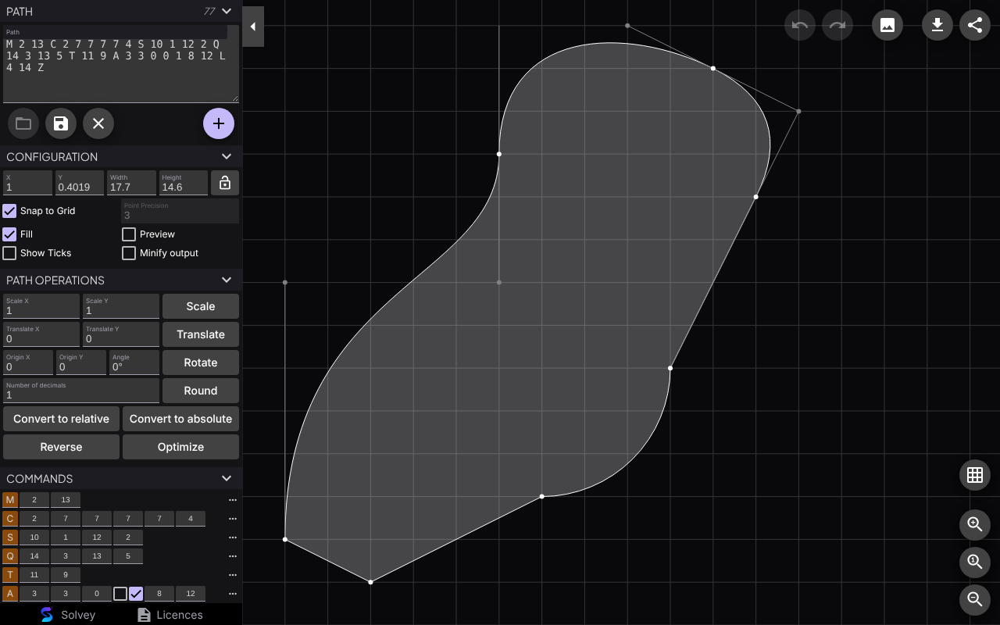

# Solvey SVG Path Editor

Live demo: https://solveyofficial.github.io/svg-path-editor/

Create and edit SVG paths visually. Paste a path, drag its points, add or
convert commands, and copy the result.



## Private by design

Everything runs in your browser. Paths and images you open are never uploaded,
and the app loads no analytics, tracking or third-party resources: fonts and
icons are served with the app itself.

## How to Use

##### Basic:
- Paste or edit the raw path in the **path** field
- Click on **+** to add a new command to the path, select a type, then click on the destination
- Move points with drag and drop
- Click on a point, then on the **...** button to insert a command right after the selected one, to remove it, or to change its type

##### Commands panel:
- Click on the command type to toggle between relative and absolute coordinates
- Relative command types are **orange**, absolute are **purple**
- Click on **...** then **Delete** to delete a command
- Click on **...** then **Insert after** to insert a new command right after the selected one
- Click on **...** then **Convert to** to convert the selected command to a new type
- Click on **...** then **Start Path From Here** to reorder the path so that the selected command becomes first
- Click on **...** then **Start Subpath From Here** to reorder the path so that the selected command becomes first in its subpath
- Click on **...** then **Reverse Subpath** to reverse the command order in the subpath of the selected command

##### ViewBox:
- Use mouse wheel, or click **Zoom in** and **Zoom out** to zoom in/out
- Use drag & drop to move the viewBox
- Click on **Zoom to Fit** to automatically set the viewBox depending on current path
- ViewBox can also be set manually with the **x**, **y**, **width** and **height** fields

##### Path operations:
- Scale the full path with the **Scale** button
- Translate the full path with the **Translate** button
- Rotate the full path with the **Rotate** button
- Round all coordinates of the current path with the **Round** button
- Convert all commands to relative or absolute coordinates with **Convert to relative** or **Convert to absolute** button
- Reverse the command order with the *Reverse* button
- Minimise the path length with the *Optimize* button

##### Shortcuts:
- Press **m**, **l**, **v**, **h**, **c**, **s**, **q**, **t**, **a** or **z** to insert a command after the selected one
- Press **shift** + **m**, **l**, **v**, **h**, **c**, **s**, **q**, **t**, **a** or **z** to convert selected command to a new type
- Press **echap** to delete the command being created, or the undo the current dragging operation
- Press **delete** or **backspace** to delete the selected command
- Press **ctrl** + **z** or **cmd** + **z** to undo
- Press **ctrl** + **shift** + **z** or **cmd** + **shift** + **z** to redo
- Press **ctrl** while dragging to ignore `snap to grid` constraint

## Development

You need Node.js 22.22.3 or later (or 24.15 or later).

```sh
npm ci          # install dependencies
npm start       # development server at http://localhost:4200
npm run lint    # lint TypeScript and templates
npm test        # unit tests (Vitest)
npm run build   # production build in dist/svg-path-editor/browser
```

When the repository is public, every push to `main` is published to GitHub Pages.

## Licence

Apache License 2.0, see LICENSE and NOTICE. This is a modified version of
SVG Path Editor by Yann Armelin. The licences of bundled third-party software
and fonts are collected into `LICENSES.txt` in each build and linked from the
app's footer.
